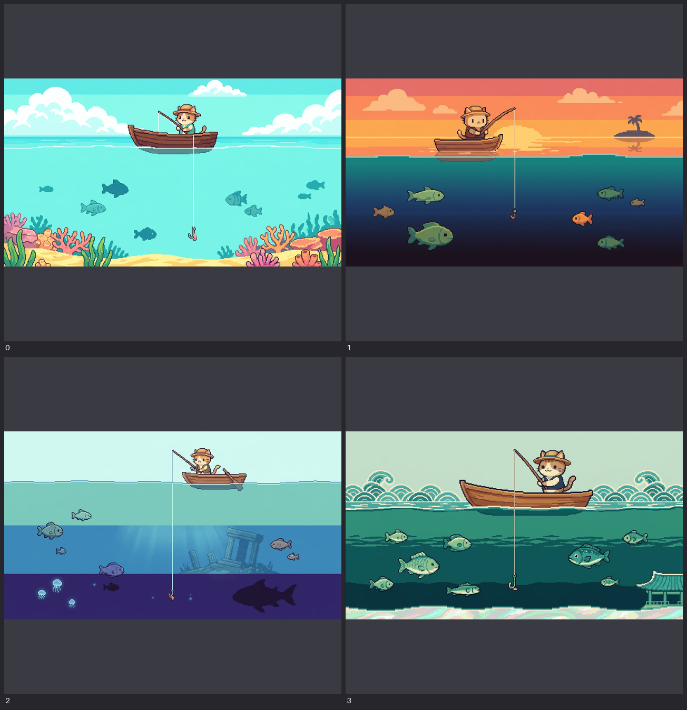
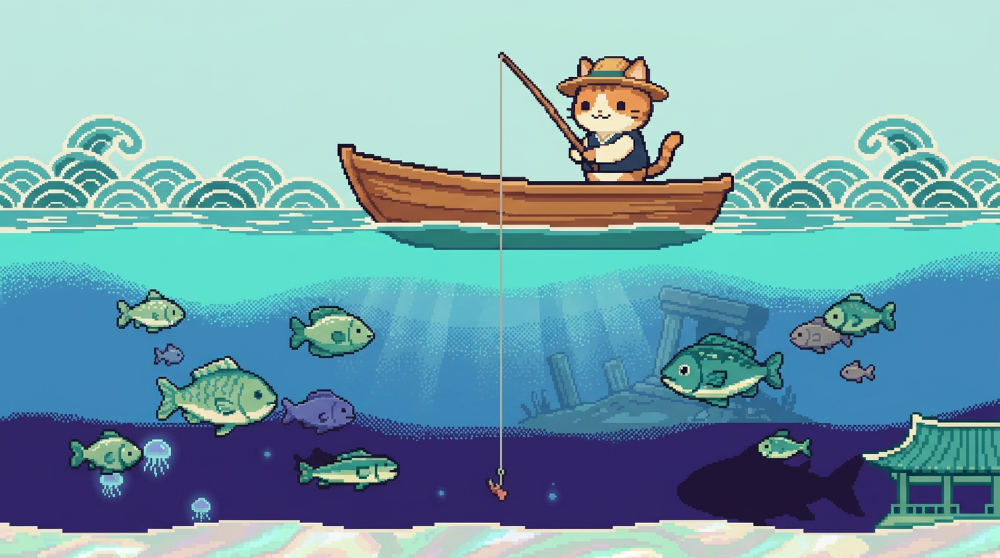
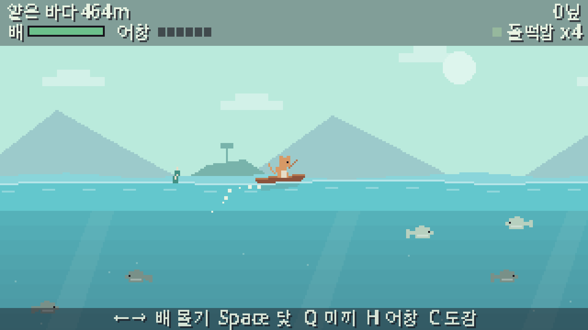
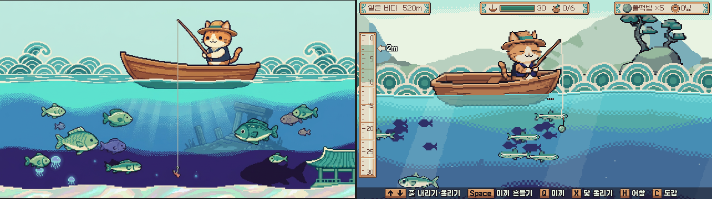
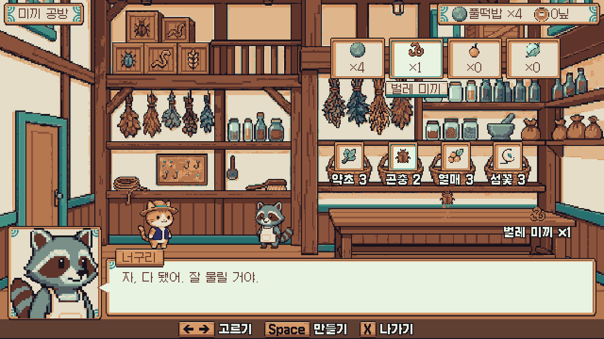
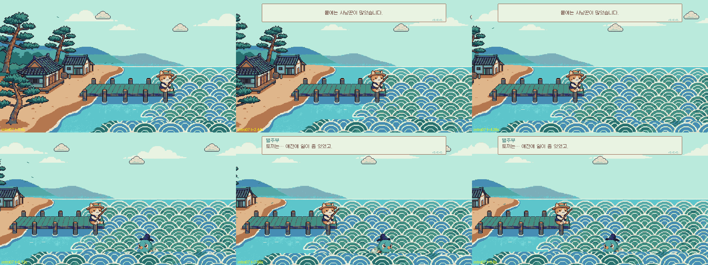

# cat-angler 제작 과정

> 문서 유형: 설명 (사례)

이 문서를 읽으면 하네스의 절차를 모두 따른 프로젝트가 사용자에게 두 번 반려당한 이유와, 반려 뒤에 무엇을 바꿨는지 알 수 있어요. cat-angler는 별주부전을 모티브로 한 2D 픽셀 낚시 게임이고 주인공은 고양이예요. 성공담이 아니라 진행 중인 기록이에요. 이 문서를 쓰는 시점(2026-11-23)에 게임은 `assets` 단계에서 다듬는 중이고, 사용자의 최종 평가는 아직 없어요.

단계와 검증 용어가 낯설면 [gameforge 하네스의 구조](harness-structure.md)와 [세 가지 검증의 역할](three-checks.md)을 먼저 읽으세요.

## 전체 흐름

```
 레퍼런스 ─► 설계 인터뷰 ─► 설계 1차 ──✗ 반려 1: "너무 단순하다"
                               │
                               ▼
                           설계 2차 (이어진 긴 바다) ─► 기준 화면 고정 ─► 그레이박스
                                                                            │
                                               ✗ 반려 2: "기준 화면과 전혀 다르다" ◄┘
                                                                            │
                                                                            ▼
                                             전면 재제작 (화면 구조 · 그림과 소리 · 컷신)
                                                                            │
                                                                            ▼
                                                  블라인드 심사 ─► 다듬는 중 (2026-11-23)
```

## 레퍼런스에서 특성 뽑기

먼저 화면의 방향을 잡았어요. 후보 156장을 모았고(`games/cat-angler/references/inbox/`의 메타 파일 156개), 사용자가 그 가운데 25장을 "이런 느낌"으로, 4장을 피할 예시로 골랐어요(`games/cat-angler/references/picked/analysis.md`).

고른 것을 그대로 따라 그리지 않고 **공통 특성**을 글로 적었어요. 예를 들면 이런 문장이에요.

- 수면이 화면을 위아래로 나눈다. 위에는 작은 배와 캐릭터, 아래에는 넓은 물속이 단면으로 보인다.
- 깊이에 따라 색이 바뀐다. 깊이가 곧 진행도다.
- 가장 어두운 색은 순수 검정이 아니라 남보라빛이다.

측정값도 같은 방향을 가리켰어요. 고른 쪽이 피할 예시보다 채도가 높고(+0.09), 차갑고(warmth −0.20), 윤곽 밀도가 낮았어요(−0.09).

쏠림 경고도 떴어요. 고른 25장 중 20장이 pinterest.com이었어요. 분석 문서는 이 경고를 숨기지 않고, Pinterest는 여러 작가의 작업이 모인 사이트라 한 작품을 따라가는 상황이 아니라고 판단한 이유를 적었어요.

수집한 이미지는 남의 저작물이라 공개 저장소에 없어요. 출처 주소가 든 메타 파일만 있어요.

## 첫 번째 반려: 너무 단순한 설계

사용자가 처음 준 것은 한 문단짜리 아이디어였어요. 메인 세션은 그것을 받아 적지 않고 인터뷰로 설계를 잡았어요. 결정을 가르는 질문을 객관식으로 묻고, 추천안과 그 선택의 대가를 함께 제시하는 방식이었어요(세션 기록).

그런데 첫 설계는 모든 것을 고정된 한 화면에 넣었어요. 사용자는 이것을 반려했어요. 인계 기록에 남은 피드백이에요(`.claude/handoffs/2026-11-23-gameforge-cat-angler.md`).

> 처음 설계(고정 한 화면)를 "너무 단순하다"고 반려했다. 다른 낚시 게임처럼 횡으로 이동하고 멀리 나갈 수 있어야 한다. 설계를 단순하게 줄이지 말 것.

왜 이런 설계가 나왔을까요. 하네스의 설계 스킬에는 범위를 줄이라는 압력이 들어 있어요. "넓은 오픈 월드, 많은 레벨"은 약점이라고 적고 "화면 한두 개 크기의 레벨 하나를 끝까지"를 대안으로 권해요(`harness/skills/gf-plan/SKILL.md`). 조사에서 나온 타당한 경고지만, 에이전트는 이 경고를 "작을수록 안전하다"로 읽었어요. 사용자가 원한 것은 작은 게임이 아니라 **끝낼 수 있는 범위 안에서 풍부한 게임**이었어요.

### 반려 뒤에 바뀐 것

설계를 하나로 이어진 긴 바다로 다시 썼어요(`games/cat-angler/design/brief.md`).

```
거리     0m          300m              900m               1800m          2400m
       ├─ 육지·항구 ─┼──── 얕은 바다 ────┼───── 먼바다 ──────┼── 심해 입구 ──┤
```

- 배를 몰아 좌우로 항해하고, 낚싯줄을 내리면 카메라가 미끼를 따라 내려가요.
- 구간은 벽이 아니라 파도로 나뉘어요. 파도, 배의 내구도, 어창 크기가 얼마나 멀리 갈지를 제한해요.
- 어군 표시, 암초, 섬, 난파선, 떠다니는 물건처럼 항해 중에 찾을 것을 넣었어요.

설계 요약의 "피할 것"에는 이 반려에서 나온 문장이 들어갔어요: "빈 바다를 오래 이동만 하는 구간. 화면 두 개 너비 안에 항상 볼거리가 있어야 한다."

## 기준 화면 고정

`look` 단계에서 기준 화면 후보 네 장을 만들었어요.



사용자가 고른 것을 합쳐 기준 화면 한 장을 만들었어요(세션 기록). 완성된 기준 화면에는 후보 2번의 깊이별 물색과 유적, 3번의 전통 물결 문양과 누각이 함께 보여요.



이 그림에서 24색 팔레트(`design/look/palette.json`)를 뽑고 아트 디렉션(`design/art-direction.md`)을 썼어요. 아트 디렉션은 "따뜻한 색은 고양이·배·육지·UI에만 쓴다. 물속은 차가운 색이다. 그래서 주인공이 항상 눈에 띈다"처럼 그림을 규칙으로 풀어 쓴 문서예요.

사용자는 설계 요약과 기준 화면을 승인했어요. `.gf/state.json`의 `look` 승인 메모는 "기준 화면, 아트 디렉션, 넓은 바다 구조로 고친 브리프"예요.

## 두 번째 반려: 그레이박스

하네스의 다음 단계는 그레이박스예요. 그림을 입히기 전에 도형만으로 플레이할 수 있는 빌드를 만들어 손맛부터 판정받는 단계예요. 조사에서도 "그래픽보다 먼저 핵심 재미를 검증한다"가 반복해서 나온 방법이었어요.

제작 에이전트는 그레이박스를 만들었고 자가 실행은 전부 통과했어요. 플레이 봇은 처음부터 엔딩까지 깼어요(게임 시간 약 27분, 출항 14번).



사용자는 63초 플레이했어요. 멸치 한 마리를 낚고 팔지 않은 채 종료했어요. 그리고 강하게 반려했어요. 인계 기록이 옮긴 내용이에요.

> 기준 화면 느낌이 아니고 너무 거칠고 단순하다, 화면이 넘어가야 한다, 미끼와 상점이 따로 구현돼야 한다, 첫 애니메이션이 나레이션 하나다, 퀄리티가 말이 안 되게 낮다.

### 이 반려에서 배운 것

**그레이박스는 이 사용자에게 소통 도구로 작동하지 않았어요.** 제작 에이전트는 "손맛을 봐 달라"고 내놨지만, 사용자가 본 것은 "승인한 기준 화면과 전혀 다른 화면"이었어요. 색 덩어리를 보고 그 너머의 완성된 게임을 상상해 달라는 요청은 개발자에게는 익숙하지만 모든 사람에게 통하지는 않아요. 인계 기록은 이 교훈을 굵게 적었어요.

> 이 사용자에게는 색 덩어리 임시 버전을 보여 주고 손맛을 묻는 방식이 통하지 않는다. 실제 품질의 화면으로 보여 줘야 한다.

**"봇이 깰 수 있다"는 "사람이 하고 싶다"와 아무 관계가 없었어요.** 27분짜리 완주 기록은 막히는 곳이 없다는 것만 증명했어요.

**구조의 문제는 손맛보다 먼저 보였어요.** 그레이박스는 항구의 가게들을 한 줄에 몰아넣었고, 여는 장면을 글 카드로 처리했어요. 사용자는 조작감을 느끼기도 전에 "가게가 따로 있는 화면이 아니다", "첫 장면이 글자뿐이다"에서 멈췄어요.

하네스의 절차가 틀렸다는 뜻은 아니에요. 절차는 조사에서 본 여러 제작자의 공통분모이고, 사용자는 한 명의 사람이에요. 단계의 순서보다 사용자의 판정이 우선해요.

## 전면 재제작

반려 뒤에 세 제작 에이전트가 계약 문서 하나(`games/cat-angler/design/asset-spec.md`)를 기준으로 동시에 다시 만들었어요(`.claude/handoffs/2026-11-23-gameforge-cat-angler.md`).

| 맡은 범위 | 만든 것 |
|---|---|
| 화면 구조 | 해상도 640×360, 장소마다 씬 분리와 전환 연출, 가게 네 곳의 전용 실내 화면, 저장, 첫 출항 길잡이 |
| 그림과 소리 | 24색 팔레트 그림 197장, 효과음 23개, 음악 9곡 (인계 기록 시점의 수. 그 뒤 다듬으면서 효과음은 28개가 됐어요. `design/asset-status.md`) |
| 컷신 | 여는 컷신 10컷 89.6초, 닫는 컷신 3컷 30.4초 (`design/cutscene-script.md`) |

설계 요약의 "닫힌 결정"에도 반려 내용이 그대로 들어갔어요.

- 육지: "화면이 나뉜다: 항구 마을(바깥), 가게마다 따로 들어가는 실내 화면, 채집지, 섬. 화면 사이는 전환 연출로 넘어간다"
- 이야기 연출: "장면마다 그린 전체 화면 그림이 움직이는 컷신. 글 카드로 대신하지 않는다"

아트 디렉션에도 한 줄이 더해졌어요: "색 덩어리만 있는 거친 도형으로 두지 않는다."

다시 만든 화면이에요. 왼쪽이 기준 화면, 오른쪽이 실행 중인 게임을 찍은 화면이에요.



가게는 각각 따로 들어가는 실내 화면이 됐고, 여는 장면은 움직이는 컷신이 됐어요.

| 미끼 공방 | 여는 컷신 7컷 |
|---|---|
|  |  |

화면 전체 모음은 `games/cat-angler/SCREENSHOTS.md`에 있어요. 게임을 다듬는 중이어서 그 문서가 가리키는 그림은 바뀔 수 있어요.

## 블라인드 심사의 판정

다시 만든 화면을 블라인드 심사에 넣었어요(`games/cat-angler/.gf/judge/history.jsonl`).

- 그레이박스 대 새 화면: 심사자는 새 화면을 골랐어요.
- 기준 화면 대 새 화면: 심사자는 기준 화면을 골랐어요.

두 번째 결과가 중요해요. 화면을 만든 에이전트가 스스로 평가했다면 놓치기 쉬운 차이예요. 맥락 없는 심사자는 고양이와 배가 작고, 물고기가 작고 옅고, 물속이 단조롭다고 지적했어요. 이 지적을 하나씩 고치는 다듬기가 진행 중이에요. 2026-11-23 기준 기록에서는 기준 화면이 다섯 번 이긴 뒤 여섯 번째 심사에서 게임 화면이 근소하게 이겼어요.

## 지금 약한 곳

저장소가 직접 적은 약점이에요(`games/cat-angler/SCREENSHOTS.md`, `design/asset-status.md`, 2026-11-23 기준).

- 바다 화면의 고양이와 배가 기준 화면보다 작게 보여요.
- 고양이의 꼬리와 귀가 움직이는 프레임이 없어요. 가게 주인의 말하는 동작은 1픽셀 까딱임이에요.
- 컷신 일부가 정적이에요.
- 소리는 측정만 했고 사람이 듣지 않았어요.
- 평균 75fps지만 느린 프레임 기준 60fps는 입증하지 못했어요.
- 사용자의 평가를 아직 받지 못했어요.

비용 기록(`games/cat-angler/.gf/ledger.jsonl`)의 합은 2026-11-23 오전에 마지막으로 셌을 때 호출 156건, 추정 $12.80이었어요. 다듬는 중이라 계속 늘고 있었어요. 인계 기록은 누적을 "약 $16"으로 적었어요. 두 값이 다른 이유를 설명하는 기록은 저장소에서 찾지 못했어요.

## 정리

| 반려 | 에이전트가 한 가정 | 사용자가 본 것 | 바뀐 것 |
|---|---|---|---|
| 1. 설계 | 범위는 작을수록 안전하다 | 다른 낚시 게임보다 훨씬 단순하다 | 이어진 긴 바다, 항해를 제한하는 파도·내구도·어창, 찾을 것들 |
| 2. 그레이박스 | 손맛은 도형으로 먼저 본다 | 승인한 기준 화면과 전혀 다르다 | 실제 품질의 화면으로 재제작, 화면 분리, 움직이는 컷신 |

- 하네스의 절차는 출발점이에요. 사용자가 무엇을 보고 판단하는 사람인지에 따라 순서를 바꿔야 해요.
- 반려 내용은 대화에서 끝내지 않고 설계 요약과 아트 디렉션의 문장으로 옮겼어요. 다음 세션과 다음 제작 에이전트가 같은 실수를 하지 않게 하기 위해서예요.
- 봇의 완주, 테스트 통과, 에이전트의 자기 평가는 사람의 "하고 싶다"를 대신하지 못했어요.

## 더 보기

- 설계가 너무 단순해지지 않게 하는 방법: [설계 인터뷰 하기](../how-tos/run-design-interview.md)
- 세 제작 에이전트가 맞물린 방법: [에이전트 작업 분할 원칙](splitting-work.md)
- 원문: `.claude/handoffs/2026-11-23-gameforge-cat-angler.md`, `games/cat-angler/design/brief.md`
