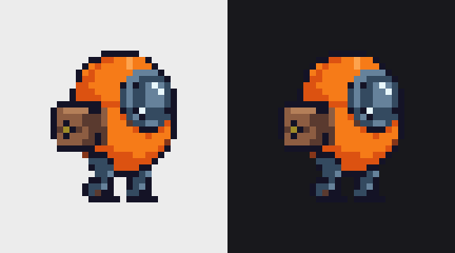

# 생성 이미지를 픽셀 에셋으로 만들기

> 문서 유형: 문제 해결 (How-to 가이드)

이 가이드를 따라 하면 이미지 모델이 그린 "픽셀 아트처럼 보이는 그림"을 게임 해상도에 정확히 맞는 진짜 픽셀 에셋으로 바꿀 수 있어요. 게임 안에서 흐려지거나 에셋마다 픽셀 크기가 달라 보이는 문제를 없애요.

## 이럴 때 쓰세요

- 생성한 픽셀 아트를 게임에 넣었더니 흐리거나 뭉개질 때
- 에셋마다 픽셀 한 칸의 크기가 달라 보일 때
- 스프라이트 테두리에 배경색이 남을 때

원인은 이미지 모델이 픽셀 아트를 그리지 못하기 때문이에요. 모델은 픽셀 아트의 **모양을 흉내 낸 고해상도 그림**을 내놓아요. 하네스가 실제로 잰 값이에요(`harness/skills/gf-assets-pixel/SKILL.md`).

| 기대한 것 | 실제로 받은 것 |
|---|---|
| 정수 픽셀 격자 | 512픽셀 그림에 칸 하나가 5.12픽셀 |
| 색 십여 개 | 색 22,180개 |
| 요청한 32×32 | 100×100칸 |

그래서 생성물은 원본으로만 다루고, 아래 후처리 사슬을 통과한 것만 게임에 넣어요.

```
 원본 ──► 크로마 ──► 격자 맞춤 ──► 팔레트 적용 ──► 검사 ──► 게임용 에셋
 assets/raw/pix     keyed        pixel          assets/game     captures/inspect
```

## 준비하기

- 게임 프로젝트의 스타일이 `pixel`이어야 해요.
- 아트 디렉션에서 캐릭터의 세로 크기(예: 24픽셀)와 색 수를 정해 두세요.
- 아래 명령의 `gf`는 게임 폴더를 지정한 함수예요. 경로는 모두 게임 폴더 기준이에요.
- **비용**: 1단계의 생성만 유료예요(이미지 1장 약 $0.08). 2단계부터는 무료예요.

에셋이 여러 개라면 가장 눈에 띄는 **하나**로 사슬 전체를 먼저 통과시키고, 사용자가 그 결과를 승인한 뒤에 나머지를 만드세요.

## 1. 단색 배경에 생성하기

배경색은 그림에 없는 색으로 정하세요. 보통 마젠타(`#FF00FF`)를 쓰고, 그림에 분홍이나 보라가 있으면 초록(`#00FF00`)을 쓰세요. 먼저 `--dry-run`으로 추정 비용을 확인하세요.

```sh
gf gen image "<대상>, pixel art, chunky large pixels, limited 16 colour palette, hard pixel edges, dark outline, side view, single subject centered with margin, flat solid pure magenta #FF00FF background, no shadow, no ground, no text" \
  --aspect 1:1 --resolution 0.5K --out assets/raw/pix --name <이름> --dry-run
```

`cost_usd`를 본 뒤 `--dry-run`을 빼고 실행하세요. 기준 화면을 참조 이미지로 주려면 `gf gen image` 대신 `gf gen edit "<프롬프트>" --image <기준 화면>`을 쓰세요. 기본 `image.concept` 모델은 이미지 입력을 받지 않아요.

**처음부터 단순하게 요청하세요.** 주름이나 무늬가 많은 그림은 24픽셀로 줄이면 얼룩이 돼요. 하네스 검증에서 통한 문구예요: `big flat colour areas with only one shadow tone, no small details, thick dark outline, very chunky huge pixels`.

## 2. 배경 빼기

`--hard`를 주면 투명도가 0 아니면 255로만 나와요. 픽셀 아트에는 반투명 가장자리가 없어야 해요.

```sh
gf post chroma assets/raw/pix/<이름>.png --key auto --hard --out assets/raw/keyed
```

결과의 `key`가 의도한 배경색과 비슷한지 확인하세요. 다르면 `--key '#FF00FF'`처럼 직접 주세요.

## 3. 격자에 맞춰 줄이기

대상의 종류에 따라 옵션이 달라요.

| 대상 | 옵션 | 이유 |
|---|---|---|
| 캐릭터, 소품 | `--trim --height <세로 픽셀>` | 모델은 요청한 크기를 지키지 않아요. 보이는 부분만 잘라 세로를 맞추고 가로는 비율대로 둬요 |
| 화면을 꽉 채우는 타일 | `--size 32x32` | 크기를 고정해요. 비율이 다르면 그림이 늘어나므로 캐릭터에는 쓰지 마세요 |
| 애니메이션 프레임 | `--cell <칸 크기>` | 모든 프레임에 같은 값을 줘야 크기가 흔들리지 않아요 |

```sh
gf post pixel-snap assets/raw/keyed/<이름>.png --trim --height 24 --out assets/raw/pixel
```

결과의 `cell`(원본 몇 픽셀이 한 칸이 됐는지)을 적어 두세요. 같은 캐릭터의 애니메이션을 만들 때 써요.

옵션 없이 실행하면 격자를 자동으로 찾아요. 생성 그림의 격자는 정수가 아니어서 신뢰도가 0.25 미만이면 실패해요. 자동 감지에 기대지 마세요.

## 4. 공용 팔레트 입히기

게임의 모든 에셋이 같은 팔레트를 써야 한 게임처럼 보여요. 팔레트가 아직 없으면 채택한 그림들에서 함께 뽑으세요.

```sh
gf post palette extract assets/raw/pixel --colors 16 --out design/palette.json
gf post palette apply assets/raw/pixel/<이름>.png --palette design/palette.json --out assets/game/sprites
```

- 그림을 바꾸면 팔레트를 다시 뽑고 **전부**에 다시 입히세요.
- 작은 스프라이트에는 `--dither`를 쓰지 마세요. 지저분해져요.

## 5. 검사하기

숫자 검사와 눈 검사를 함께 하세요.

```sh
gf post inspect assets/game/sprites/<이름>.png --check captures/inspect/<이름>.png --check-scale 8
```

```json
{"ok": true, "files": ["captures/inspect/player.png"], "cost_usd": 0.0, "images": [{"file": "assets/game/sprites/player.png", "size": [20, 24], "alpha_coverage": 0.7083, "partial_alpha": 0.0, "unique_colours": 12, "integer_scale": 1, "pixel_art": true, "reasons": []}]}
```

`pixel_art`가 `true`여야 해요. `false`면 `reasons`가 원인을 말해 줘요. 그다음 확인 이미지(`captures/inspect/<이름>.png`)를 직접 열어 보세요.



## 결과 확인하기

네 가지가 모두 맞으면 통과예요(`harness/skills/gf-assets-pixel/SKILL.md`의 통과 기준).

1. `gf post inspect`가 `pixel_art: true`를 내요.
2. 확인 이미지의 밝은 쪽과 어두운 쪽 **모두에서** 테두리에 배경색이 없고, 외곽선이 끊기지 않고, 형태가 읽혀요.
3. 1배 크기에서 무엇인지 알아볼 수 있어요. 확대해야만 알아볼 수 있으면 더 단순한 형태로 다시 생성하세요.
4. 기준 화면 옆에 놓았을 때 같은 게임의 그림으로 보여요.

게임에 넣은 뒤에는 `gf check assets`, `gf engine test`, `gf engine capture`로 게임 안에서도 흐려지지 않는지 확인하세요.

## 잘 안 될 때

| 증상 | 원인 | 해결 |
|---|---|---|
| 줄이니 얼룩이 됐다 | 원본에 주름, 패널, 명암 줄이 많다 | 큰 색면과 음영 한 단계로 다시 생성 |
| 가는 가시나 줄무늬가 사라지고 갈색으로 뭉쳤다 | 1배에서 살아남지 못하는 형태다 | 굵은 덩어리와 뚜렷한 색면으로 다시 생성 |
| 다른 그림의 색이 엉뚱한 곳에 박혔다 | 팔레트를 여러 그림에서 뽑았다 | 확인 이미지에서 찾아 그 그림을 고치거나 팔레트의 색 수를 조정 |
| 눈의 흰자처럼 작은 밝은 면이 사라졌다 | 팔레트를 뽑을 때 면적이 작은 색이 밀려났다 | 하네스를 만들 때 겪은 문제예요(세션 기록). 지금의 `gf post palette extract`는 넓게 퍼진 색 무리부터 나누는 방식이에요(`harness/tools/gf/post/palette.py`). 그래도 사라지면 `--colors`를 늘리세요 |

## 더 보기

- 처음부터 끝까지 따라 하기: [첫 게임 실행하고 캐릭터 넣기](../tutorials/first-game.md)
- 걷는 동작 만들기: [스프라이트 애니메이션 만들기](make-sprite-animation.md)
- 원문: `harness/skills/gf-assets-pixel/SKILL.md`
