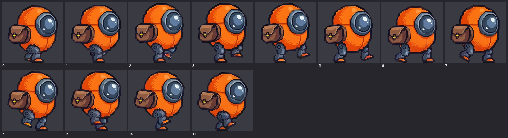

# 스프라이트 애니메이션 만들기

> 문서 유형: 문제 해결 (How-to 가이드)

이 가이드를 따라 하면 정지 스프라이트 한 장에서 걷기 같은 짧은 반복 동작의 스프라이트 시트를 얻을 수 있어요. 영상을 한 번만 생성하고 나머지는 무료 후처리 명령으로 처리해요.

## 이럴 때 쓰세요

- 캐릭터가 미끄러지듯 움직여서 걷는 동작이 필요할 때
- 프레임을 한 장씩 생성했더니 장마다 캐릭터가 달라질 때

프레임을 따로따로 생성하면 모델이 매번 다른 캐릭터를 그려요. 정지 스프라이트를 첫 프레임으로 영상을 **한 번** 만들고, 그 영상을 프레임으로 나누면 같은 캐릭터가 유지돼요.

```
 정지 원본 ─► 영상(유료) ─► 프레임 ─► 크로마 ─► 정렬 ─► 반복 구간 ─► 격자 맞춤 ─► 팔레트 ─► 시트
```

## 준비하기

- [생성 이미지를 픽셀 에셋으로 만들기](make-pixel-asset.md)를 끝낸 정지 스프라이트가 있어야 해요. 그때 나온 `cell` 값과 팔레트(`design/palette.json`)를 써요.
- ffmpeg가 설치돼 있어야 해요.
- **비용**: 1단계의 영상 생성만 유료예요. 하네스 검증에서는 3초 영상 한 번에 약 $0.34였어요(`demo-check/pixel-godot/.gf/ledger.jsonl`). 2단계부터는 무료예요.
- **무료로 연습하기**: 저장소에 검증 때 만든 영상이 있어요(`demo-check/pixel-godot/assets/raw/video/player-walk.mp4`). `demo-check/pixel-godot` 폴더를 다른 곳에 복사한 뒤 그 사본을 게임 폴더로 지정하면 2단계부터 그대로 따라 할 수 있어요. 아래 예시 출력은 그렇게 실행한 결과예요.

## 1. 영상 한 번 생성하기

첫 프레임으로 **후처리 전의 큰 원본**(단색 배경 그대로)을 주세요. 1배로 줄인 그림을 넣으면 영상 모델이 뭉개요. 먼저 `--dry-run`으로 추정 비용을 확인하세요.

```sh
gf gen video assets/raw/pix/<이름>.png --role video.sprite \
  --prompt "side view walk cycle animation loop of <캐릭터> walking in place toward the right, legs alternate stepping with clear big steps, knees lifting, body bobs up and down slightly, stays in the center of the frame and does not travel, static locked camera, background stays flat solid magenta" \
  --duration 3 --out assets/raw/video --name <이름>-walk --dry-run
```

`cost_usd`를 본 뒤 `--dry-run`을 빼고 실행하세요. 프롬프트에는 제자리 걷기, 옆모습, 다리가 번갈아 크게 움직임, 화면 가운데에 머묾, 배경색 유지를 모두 적으세요. `--end-image`는 쓰지 마세요. 기본 `video.sprite` 모델이 받지 않아서 실패해요.

## 2. 프레임으로 나누고 배경 빼기

영상을 초당 12장으로 나누고 배경을 빼세요.

```sh
gf post frames assets/raw/video/<이름>-walk.mp4 --fps 12 --out assets/raw/frames/<이름>-walk
gf post chroma assets/raw/frames/<이름>-walk --key auto --despill 5 --erode 2 --hard --out assets/raw/keyed/<이름>-walk
```

3초 영상에서 프레임 37장이 나와요. `--despill 5 --erode 2`가 중요해요. 영상은 압축 때문에 배경색이 캐릭터 외곽선으로 번져요. 정지 그림에 쓰는 기본값(3, 1)으로는 테두리에 배경색이 남아요.

## 3. 정렬하고 반복 구간 고르기

프레임마다 캐릭터의 위치가 조금씩 달라요. 발 기준선을 맞춘 뒤, 처음과 끝이 가장 매끄럽게 이어지는 구간을 고르세요.

```sh
gf post align assets/raw/keyed/<이름>-walk --anchor bbox --out assets/raw/aligned/<이름>-walk
gf post loop assets/raw/aligned/<이름>-walk --min-length 6 --max-length 12 --out assets/raw/loop/<이름>-walk
```

`gf post loop`의 결과예요. 37장 가운데 7번부터 12장을 골랐어요.

```json
{"ok": true, "files": ["..."], "cost_usd": 0.0, "total_frames": 37, "start": 7, "end": 19, "length": 12, "seam": 0.00973, "mean_step": 0.05144}
```

`seam`은 마지막 프레임과 첫 프레임의 차이예요. `mean_step`(이웃한 프레임 사이의 평균 차이)보다 작으면 이음매가 눈에 띄지 않아요.

고른 프레임을 모음판으로 만들어 눈으로 확인하세요.

```sh
gf post contact assets/raw/loop/<이름>-walk --out captures/inspect/<이름>-walk-loop.png --columns 8
```



다리가 번갈아 움직이는지, 프레임 사이에 색이나 소품이 바뀌지 않는지 보세요. 영상 모델은 소품을 흔히 바꿔요. 바뀐 프레임은 빼세요.

## 4. 모든 프레임을 같은 격자로 줄이기

`--cell`을 **모든 프레임에 똑같이** 주세요. 프레임마다 `--trim --height`를 쓰면 프레임마다 크기가 달라져요. 값은 이렇게 계산해요.

```
--cell = 정지 스프라이트의 cell × (영상 가로 ÷ 정지 원본 가로)
예: 13.58 × (960 ÷ 512) = 25.47
```

```sh
gf post pixel-snap assets/raw/loop/<이름>-walk --cell 25.47 --out assets/raw/pixel/<이름>-walk
gf post palette apply assets/raw/pixel/<이름>-walk --palette design/palette.json --out assets/raw/paletted/<이름>-walk
```

예시에서는 프레임 12장이 모두 21×25가 됐고, 색은 303개에서 11개로 줄었어요.

## 5. 시트로 묶기

프레임을 스프라이트 시트로 묶으세요. 시트 PNG, 프레임 좌표가 든 JSON, Godot용 `.tres`가 함께 생겨요.

```sh
gf post sheet assets/raw/paletted/<이름>-walk --name <이름>_walk --fps 12 --out assets/game/sprites
```

```json
{"ok": true, "files": [".../player_walk.png", ".../player_walk.json", ".../player_walk.tres"], "cost_usd": 0.0, "frames": 12, "sheet_size": [84, 75], "frame_size": [21, 25], "texture": "res://.../player_walk.png"}
```

반복하지 않는 동작(공격, 사망)에는 `--no-loop`을 붙이세요. Godot 2D 템플릿은 `--name player_walk --out assets/game/sprites`로 만든 시트를 플레이어에 바로 써요.

## 결과 확인하기

- `gf post inspect assets/game/sprites/<이름>_walk.png`가 `pixel_art: true`를 내요.
- 게임에서 걷는 동안의 연속 화면을 찍어 발이 미끄러지지 않는지, 기준선이 튀지 않는지 보세요.

```sh
gf engine capture --out captures/anim-<이름> --script bot/clear.json --at 0.5,0.6,0.7,0.8
```

- 움직임의 느낌은 사람이 봐야 해요. `gf engine run`으로 사용자에게 보여 주고 물으세요.

## 알아 둘 한계

- **대기 자세가 따로 없어요.** 영상 모델은 걷기 시작하면서 자세를 바꿔요. 그래서 정지 스프라이트와 걷기 프레임을 섞으면 튀어요. 템플릿은 걷기 시트의 첫 프레임을 대기 자세로 쓰는데, 한 발을 든 자세라 멈춰 있어도 걷는 것처럼 보일 수 있어요(`demo-check/EVIDENCE.md` D절에서 "약함"으로 판정했어요).
- **두 번 다시 만들어도 어색하면 동작을 단순하게 바꾸세요.** 같은 영상을 계속 다시 뽑지 마세요. cat-angler의 고양이는 영상 대신 자세 시트를 편집 생성하고, 숨쉬기와 깜박임은 픽셀을 옮겨서 만들었어요(`games/cat-angler/design/asset-status.md`).

## 더 보기

- 비픽셀 2D 스타일의 같은 절차: `harness/skills/gf-assets-2d/SKILL.md`
- 원문: `harness/skills/gf-assets-pixel/animation.md`
