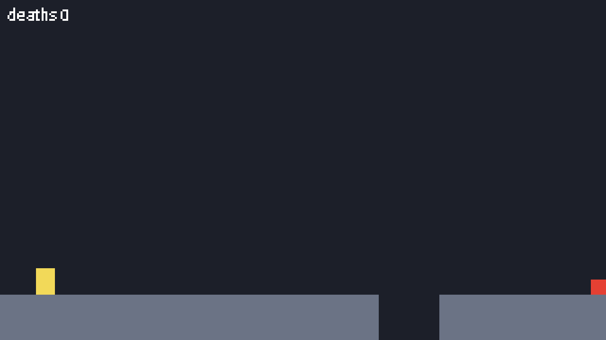
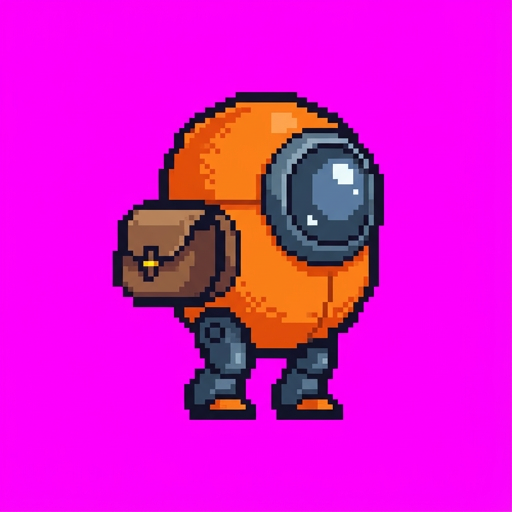
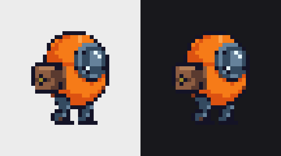
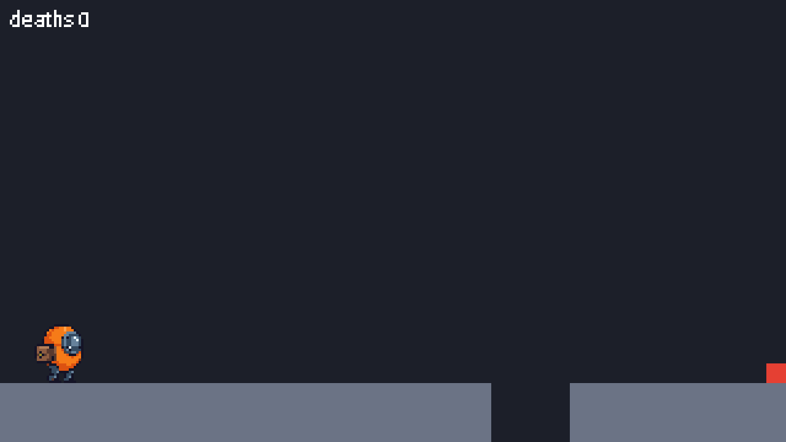

# 첫 게임 실행하고 캐릭터 넣기

> 문서 유형: 학습 (튜토리얼)

이 튜토리얼을 끝내면 gameforge로 만든 작은 게임에 여러분이 후처리한 픽셀 캐릭터가 서 있는 스크린샷을 얻어요. 그 과정에서 하네스의 핵심 흐름인 "실행한다 → 찍는다 → 본다"와 픽셀 에셋의 후처리 사슬을 손으로 한 번 거쳐요.

코딩 에이전트 없이 터미널에서 `gf` 명령을 직접 실행해요. 에이전트가 스킬을 읽고 실행하는 명령과 똑같은 명령이에요.

## 목표

- 저장소를 내려받고 환경을 점검해요.
- 템플릿으로 게임 프로젝트를 만들고 실행해요.
- 스모크 테스트, 스크린샷, 플레이 봇으로 게임을 확인해요.
- 생성 이미지 한 장을 후처리 사슬에 통과시켜 게임에 넣어요.

**비용**: 7단계에서 "저장소에 든 원본 쓰기"를 고르면 전체가 무료예요. "새로 생성하기"를 고르면 이미지 1장에 약 $0.08이 들어요. 나머지 단계는 모두 무료예요.

## 준비하기

macOS 기준이에요. 아래 도구를 설치하세요.

```sh
brew install uv ffmpeg
brew install --cask godot
```

- uv는 `gf`를 실행하고, Godot은 게임을 실행하고, ffmpeg는 영상과 소리를 다뤄요.
- Blender, node, bun은 이 튜토리얼에서 쓰지 않아요.
- 모든 명령은 **저장소 루트**에서 실행해요.

## 1. 저장소 내려받기

저장소를 내려받고 `gf`가 쓰는 Python 패키지를 설치하세요.

```sh
git clone https://github.com/lofcgi/gameforge.git
cd gameforge
(cd harness/tools && uv sync)
```

마지막 명령이 `Resolved 28 packages`와 비슷한 줄로 끝나면 준비됐어요.

## 2. 환경 점검하기

`gf doctor`로 필요한 도구가 있는지 확인하세요.

```sh
uv run -q --project harness/tools gf doctor
```

이런 JSON 한 줄이 나와요. 버전 숫자는 달라도 돼요.

```json
{"ok": true, "tools": {"godot": "4.7.2.stable.official.ed1daf0bf", "blender": "Blender 5.3.0", "ffmpeg": "ffmpeg version 8.1 ...", "node": "v26.13.0", "bun": "1.3.13"}, "chrome": true, "fal_key": true, "missing": []}
```

확인할 것은 두 가지예요.

- `tools`의 `godot`과 `ffmpeg`에 버전이 들어 있어야 해요. `missing`에 `blender`, `node`, `bun`이 있어도 이 튜토리얼은 진행할 수 있어요.
- `fal_key`가 `false`여도 무료 경로는 끝까지 갈 수 있어요.

`gf`의 모든 명령은 이렇게 마지막 줄에 JSON을 내요. `"ok": true`면 성공이에요.

## 3. 게임 프로젝트 만들기

명령이 길어서 먼저 짧은 함수를 만들어요. 이 함수는 `games/first-game` 폴더를 게임 프로젝트로 지정해서 `gf`를 실행해요.

```sh
gf() { uv run -q --project harness/tools gf --project games/first-game "$@"; }
```

템플릿으로 프로젝트를 만드세요. Godot 엔진, 2D, 픽셀 아트 스타일을 골라요.

```sh
gf init --engine godot --dim 2d --style pixel --name first-game
```

```json
{"ok": true, "project": ".../games/first-game", "template": "godot-2d", "render": {"units": [320, 180], "pixels_per_unit": 1, "filter": "nearest", "scaling": "integer"}, "state": {"name": "first-game", "engine": "godot", "dim": "2d", "style": "pixel", "stage": "plan", "approvals": [], "created": "..."}}
```

`render`를 보면 이 게임은 320×180 해상도로 그리고 정수배로만 확대해요. 픽셀 아트가 흐려지지 않게 하는 설정이에요. `stage`는 첫 단계인 `plan`이에요.

`games/first-game` 안에 `.gf`, `gf`, `scenes`, `scripts`, `assets`, `bot`, `captures`, `design`, `references` 폴더가 생겼는지 확인하세요.

## 4. 게임 실행하기

스모크 테스트로 게임이 뜨는지 확인하세요. 창이 잠깐 열렸다 닫혀요.

```sh
gf engine test
```

```json
{"ok": true, "files": ["captures/test/first_frame.png", "captures/test/result.json"], "checks": {"boot": "ok", "contract": "ok", "first_frame": "ok", "input_liveness": "ok", "no_errors": "ok"}, "load_s": 0.746, "logs": []}
```

`checks`의 다섯 항목이 모두 `ok`여야 해요. 부팅, 브리지 계약, 첫 화면, 입력 반응, 콘솔 오류 없음을 뜻해요.

직접 플레이해 보세요. 창을 닫으면 명령이 끝나요.

```sh
gf engine run
```

| 키 | 동작 |
|---|---|
| ← → 또는 A D | 좌우 이동 |
| Space 또는 ↑ | 점프 |

노란 네모가 플레이어이고 오른쪽 끝의 빨간 네모가 목표예요. 아직 그림이 없는 그레이박스 상태예요.

## 5. 스크린샷 찍기

실행 1초와 3초 시점의 화면을 찍으세요. 에이전트가 "화면을 직접 본다"고 할 때 쓰는 명령이에요.

```sh
gf engine capture --out captures/first --at 1,3
```

```json
{"ok": true, "files": ["captures/first/shot_01_t1.00.png", "captures/first/shot_02_t3.00.png", "captures/first/capture.json"], "shots": 2, ...}
```

`games/first-game/captures/first/shot_01_t1.00.png`를 열어 보세요. 아래와 같은 화면이에요.



## 6. 플레이 봇으로 끝까지 가기

템플릿에는 레벨을 깨는 고정 입력(`bot/clear.json`)이 들어 있어요. 플레이 봇에게 이 입력으로 목표까지 가게 하세요.

```sh
gf engine bot --policy bot/clear.json --require-goal
```

```json
{"ok": true, "files": ["captures/bot/clear-.../shot_001.png", "...", "captures/bot/clear-.../result.json"], "reached_goal": true, "time_s": 6.6, "deaths": 0, "liveness": {"verified": true, ...}, "inputs": {"pressed": 4, "responded": 4, "unmapped": 0, "unverified": 0, "unresponsive": []}, "errors": 0, "warnings": 0}
```

`reached_goal`이 `true`이고 `inputs.unresponsive`가 비어 있어야 해요. 봇이 누른 입력 4개에 게임이 모두 반응했다는 뜻이에요. 하네스는 반응 없는 입력을 버그로 다뤄요.

## 7. 원본 이미지 준비하기

이제 노란 네모를 캐릭터로 바꿔요. 먼저 생성 모델이 만든 원본 한 장이 필요해요. 두 방법 중 하나를 고르세요.

### 저장소에 든 원본 쓰기 (무료)

하네스를 검증할 때 생성한 로봇 그림이 저장소에 있어요. 게임 폴더의 원본 자리로 복사하세요.

```sh
mkdir -p games/first-game/assets/raw/pix
cp demo-check/pixel-godot/assets/raw/pix/player.png games/first-game/assets/raw/pix/player.png
```

### 새로 생성하기 (유료, 약 $0.08)

fal 계정의 `FAL_KEY`가 필요해요. 저장소 루트에서 `.env.example`을 `.env`로 복사한 뒤 여러분의 키를 넣으세요. 그다음 `--dry-run`으로 추정 비용부터 확인하세요. 이 명령은 돈이 들지 않아요.

```sh
gf gen image "a single game sprite: a small round delivery robot with an orange body, one big round visor eye, two short legs, standing, full body, strict side view facing right, pixel art, chunky large pixels, limited 16 colour palette, hard pixel edges, dark outline, single subject centered with margin, flat solid pure magenta #FF00FF background, no shadow, no ground, no text" \
  --aspect 1:1 --resolution 0.5K --out assets/raw/pix --name player --dry-run
```

```json
{"ok": true, "files": [], "dry_run": true, "role": "image.concept", "endpoint": "fal-ai/nano-banana-2", ..., "cost_usd": 0.08, "cost_note": "해상도·옵션에 따른 배수는 단가 API 에 없어 기본 단가로만 계산했다."}
```

`cost_usd`를 확인했으면 같은 명령에서 `--dry-run`만 빼고 실행하세요. `assets/raw/pix/player.png`가 생기고, 호출 내용이 `games/first-game/.gf/ledger.jsonl`에 한 줄 남아요. 새로 생성하면 그림이 달라서 아래 단계의 숫자도 달라져요.

### 원본 검사하기

어느 쪽을 골랐든 원본을 검사해 보세요.

```sh
gf post inspect assets/raw/pix/player.png
```

```json
{"ok": true, ..., "images": [{"file": "assets/raw/pix/player.png", "size": [512, 512], ..., "unique_colours": 24970, "integer_scale": 1, "pixel_art": false, "reasons": ["색이 24970개로 한도 64개를 넘는다"]}]}
```

`pixel_art`가 `false`예요. 이 그림은 픽셀 아트처럼 보이지만 512×512 크기에 색이 24,970개인 평범한 그림이에요. 이대로 게임에 넣으면 크기도 맞지 않고 흐려져요.



## 8. 후처리 사슬 통과시키기

원본을 네 단계로 게임용 에셋으로 바꿔요. 한 줄씩 실행하고 출력을 확인하세요.

**배경을 빼요.** `--key auto`가 테두리 색을 배경으로 판단하고, `--hard`가 반투명 가장자리를 남기지 않아요.

```sh
gf post chroma assets/raw/pix/player.png --key auto --hard --out assets/raw/keyed
```

```json
{"ok": true, "files": ["assets/raw/keyed/player.png"], ..., "images": [{"file": "assets/raw/keyed/player.png", "key": "#FB05FA", "alpha_coverage": 0.2354}]}
```

`key`가 마젠타에 가까운 색(`#FB05FA`)이면 배경을 제대로 찾은 거예요. 캐릭터는 그림 전체의 약 24%만 차지했어요.

**격자에 맞춰 줄여요.** `--trim`이 캐릭터만 잘라 내고, `--height 24`가 세로를 24픽셀로 맞춰요.

```sh
gf post pixel-snap assets/raw/keyed/player.png --trim --height 24 --out assets/raw/pixel
```

```json
{"ok": true, "files": ["assets/raw/pixel/player.png"], "previews": ["captures/inspect/pixel/pixel/player_x14.png"], ..., "images": [{..., "cell": [13.583, 13.583], ..., "size": [20, 24], "unique_colours": 260}]}
```

512픽셀짜리 그림이 20×24가 됐어요. `cell`은 원본의 약 13.58픽셀이 게임의 1픽셀이 됐다는 뜻이에요.

**팔레트를 뽑아 입혀요.** 12색 팔레트를 만들고 그 색으로만 칠해요.

```sh
gf post palette extract assets/raw/pixel/player.png --colors 12 --out design/palette.json
gf post palette apply assets/raw/pixel/player.png --palette design/palette.json --out assets/game/sprites
```

```json
{"ok": true, "files": ["assets/game/sprites/player.png"], ..., "palette_size": 12, "images": [{"file": "assets/game/sprites/player.png", "colours_before": 260, "colours_after": 12}]}
```

색이 260개에서 12개로 줄었어요. 결과는 게임용 에셋 자리인 `assets/game/sprites/`에 들어갔어요.

**검사해요.** 밝은 배경과 어두운 배경에 8배로 올린 확인 이미지도 함께 만들어요.

```sh
gf post inspect assets/game/sprites/player.png --check captures/inspect/player.png --check-scale 8
```

```json
{"ok": true, "files": ["captures/inspect/player.png"], ..., "images": [{"file": "assets/game/sprites/player.png", "size": [20, 24], ..., "partial_alpha": 0.0, "unique_colours": 12, "integer_scale": 1, "pixel_art": true, "reasons": []}]}
```

`pixel_art`가 `true`로 바뀌었어요. `games/first-game/captures/inspect/player.png`를 열어 양쪽 배경 모두에서 테두리에 마젠타가 남지 않았는지 눈으로 확인하세요.



## 9. 게임에 넣기

Godot 2D 템플릿은 `assets/game/sprites/player_walk.tres` 파일이 있으면 플레이어 그림으로 써요. 방금 만든 한 장으로 1프레임짜리 스프라이트 시트를 만드세요.

```sh
gf post sheet assets/game/sprites/player.png --name player_walk --fps 12 --out assets/game/sprites
```

```json
{"ok": true, "files": ["assets/game/sprites/player_walk.png", "assets/game/sprites/player_walk.json", "assets/game/sprites/player_walk.tres"], ..., "frames": 1, "sheet_size": [20, 24], "frame_size": [20, 24], "texture": "res://assets/game/sprites/player_walk.png"}
```

에셋을 넣었으니 다시 확인해요. 게임 코드가 가리키는 에셋이 모두 있는지 검사하고, 스모크 테스트를 돌리고, 같은 시점의 화면을 찍으세요.

```sh
gf check assets
gf engine test
gf engine capture --out captures/with-sprite --at 1,3
```

`gf check assets`는 `"ok": true`와 `"problems": []`를, `gf engine test`는 4단계와 같은 다섯 항목 `ok`를 내야 해요.

## 최종 결과 확인하기

`games/first-game/captures/with-sprite/shot_01_t1.00.png`를 열어 보세요. 노란 네모가 있던 자리에 로봇이 서 있으면 성공이에요.



5단계의 스크린샷과 나란히 놓고 보세요. 같은 명령, 같은 시점으로 찍었기 때문에 달라진 것은 플레이어 그림뿐이에요. 하네스에서 화면 변경을 확인하는 방법이 바로 이 전후 비교예요.

여기까지 한 일을 정리하면 이래요.

| 한 일 | 쓴 명령 | 하네스에서의 의미 |
|---|---|---|
| 게임이 뜨는지 확인 | `gf engine test` | 자가 실행. 변경할 때마다 돌려요 |
| 화면을 직접 봄 | `gf engine capture` | 근거 규칙. 본 것만 말해요 |
| 끝까지 깰 수 있는지 확인 | `gf engine bot` | 반응 없는 입력을 찾아요 |
| 원본을 게임용 에셋으로 | `gf post chroma → pixel-snap → palette → inspect` | 후처리 사슬. 원본은 게임에 바로 들어가지 않아요 |

실습 폴더가 필요 없으면 `games/first-game`을 지우세요.

## 자주 막히는 곳

**`no such file or directory: uv run -q ...` 오류가 나요.**
zsh에서 명령을 변수에 담으면(`GF="uv run ..."; $GF doctor`) 변수 전체를 파일 이름 하나로 읽어서 실패해요. 3단계처럼 함수로 만드세요.

**`gf doctor`의 `godot`이 `null`이에요.**
터미널에서 `godot --version`이 실행되는지 확인하세요. `brew install --cask godot`으로 설치하면 `godot` 명령이 생겨요.

**`gf gen image`가 키 오류로 실패해요.**
`.env` 파일이 저장소 루트(게임 폴더나 그 위 폴더)에 있고 `FAL_KEY`가 들어 있는지 확인하세요. 무료 경로에서는 이 명령을 쓰지 않아요.

**`gf post pixel-snap`을 옵션 없이 실행했더니 실패해요.**
옵션이 없으면 격자를 자동으로 찾는데, 생성 그림의 격자는 정수가 아니라서 신뢰도가 낮으면 실패해요. 캐릭터와 소품에는 `--trim --height <픽셀 수>`를 주세요. 이유는 [생성 이미지를 픽셀 에셋으로 만들기](../how-tos/make-pixel-asset.md)에 있어요.

**실행 결과의 `logs`에 "눌러 둔 키가 풀렸다"는 오류가 있어요.**
자동 실행 중에 게임 창을 클릭해 활성화하면 생겨요. 그 실행은 버리고 다시 돌리세요.

## 다음에 읽을 문서

- 캐릭터를 걷게 만들기: [스프라이트 애니메이션 만들기](../how-tos/make-sprite-animation.md)
- 화면이 나아졌는지 판정받기: [블라인드 심사 돌리기](../how-tos/run-blind-judge.md)
- 에이전트와 함께 단계별로 진행하기: 게임 폴더에서 `claude --plugin-dir <저장소 경로>/harness`를 실행하고 세션 안에서 `/gameforge:gf-start`를 입력하세요(`harness/README.md`).
- 전체 명령: [`gf` 명령 모음](../reference/gf-commands.md)
