# 화면 모음 (2026-11-23)

그림·소리·컷신·화면 구조를 다시 만든 뒤의 실제 게임 화면이다. 전부 `gf engine capture` 로 실행 중인 게임에서 찍었다. 기준 해상도 640×360.

목표로 삼은 기준 화면은 [`design/look/target.png`](design/look/target.png) 이다.

## 기준 화면과 게임 화면 비교

맥락 없는 심사 에이전트는 예전 색 덩어리 버전보다는 새 화면을, 새 화면보다는 기준 화면을 골랐다. 남은 차이는 아래 "아직 약한 것"에 적었다.

## 타이틀과 여는 컷신

여는 컷신은 10컷 89.6초, 닫는 컷신은 3컷 30.4초다. 아래는 컷마다 시작·중간·끝을 찍은 모음이다.

| | |
|---|---|
|  | 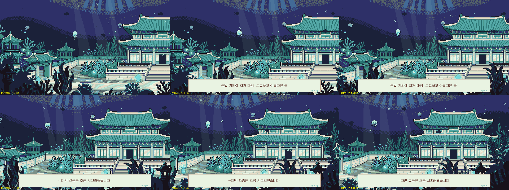 |
|  | 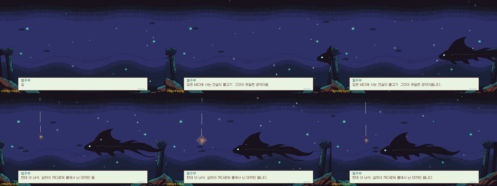 |
|  |  |
| 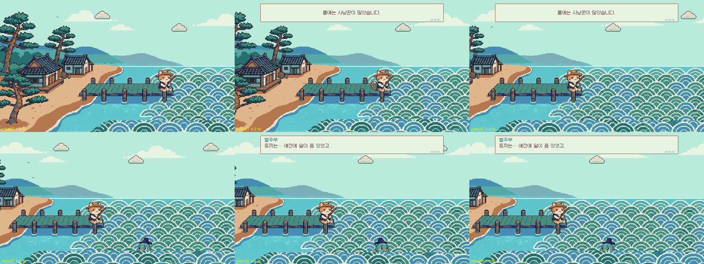 |  |
|  | 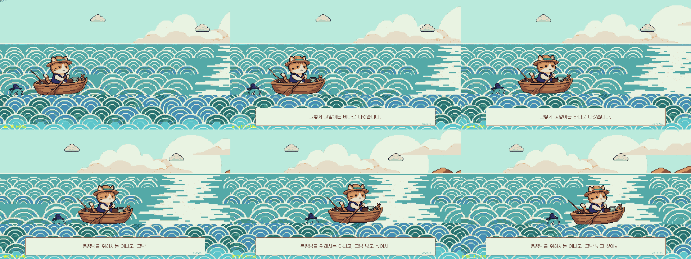 |
| 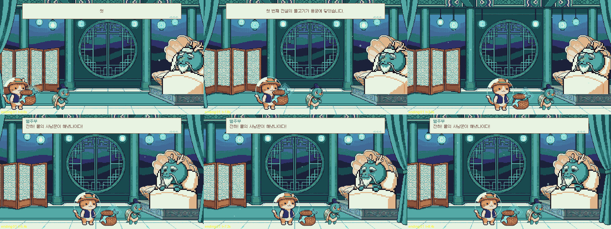 | 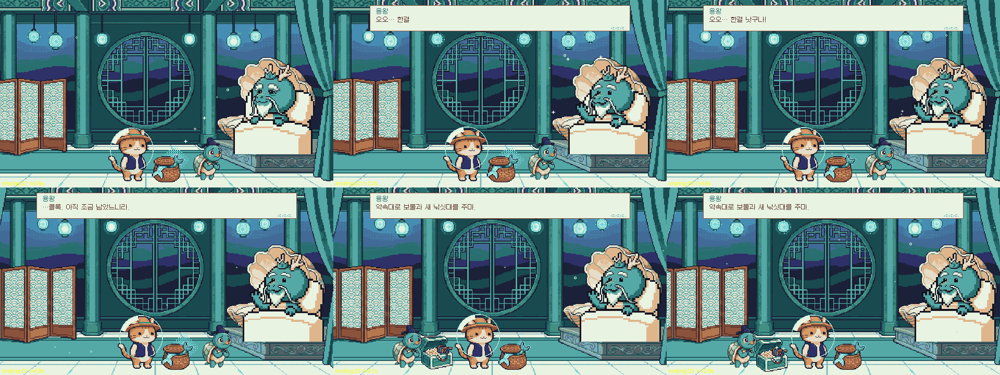 |

## 항구 마을과 채집지

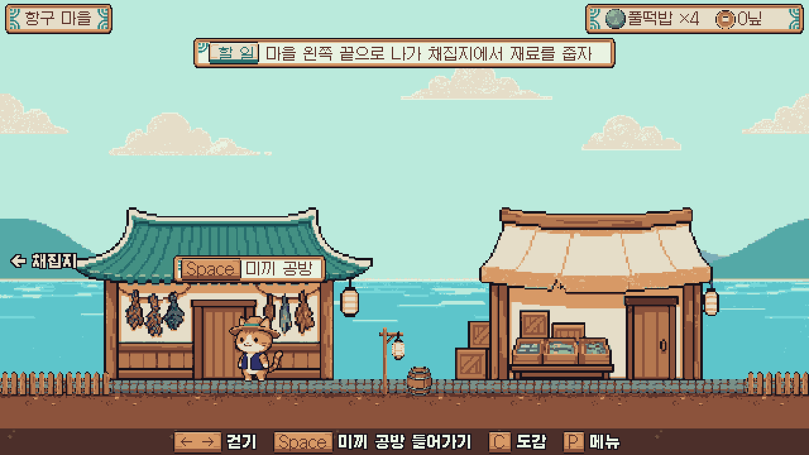
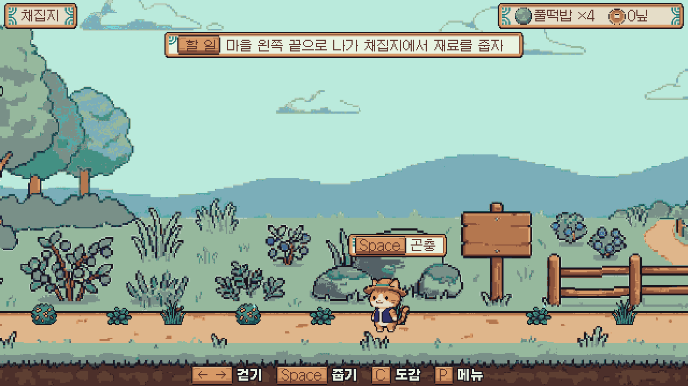

## 가게 (각각 따로 들어가는 실내 화면)

| 미끼 공방 | 어시장 |
|---|---|
|  |  |

| 조선소 | 낚시 가게 |
|---|---|
| 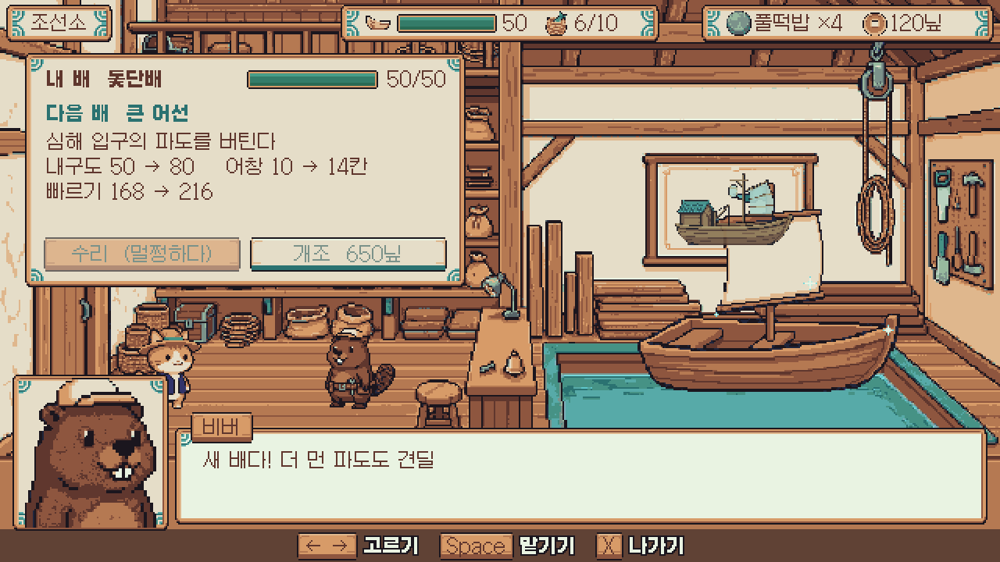 |  |

## 바다

| 얕은 바다 | 먼바다 | 심해 입구 |
|---|---|---|
|  |  | 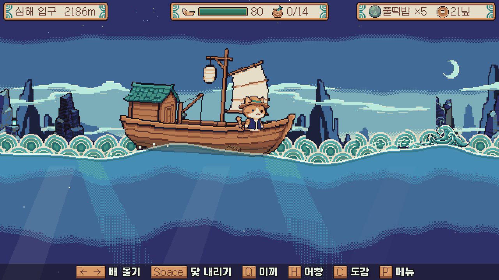 |

낚시(카메라가 미끼를 따라 내려간다):

전설의 심해어와 닫는 장면까지:

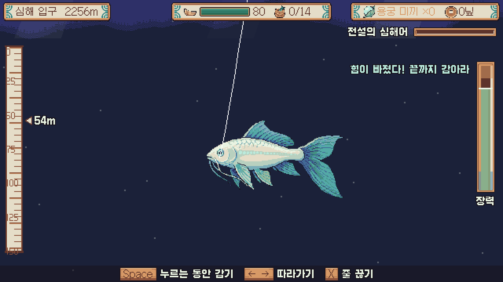

## 섬과 도감

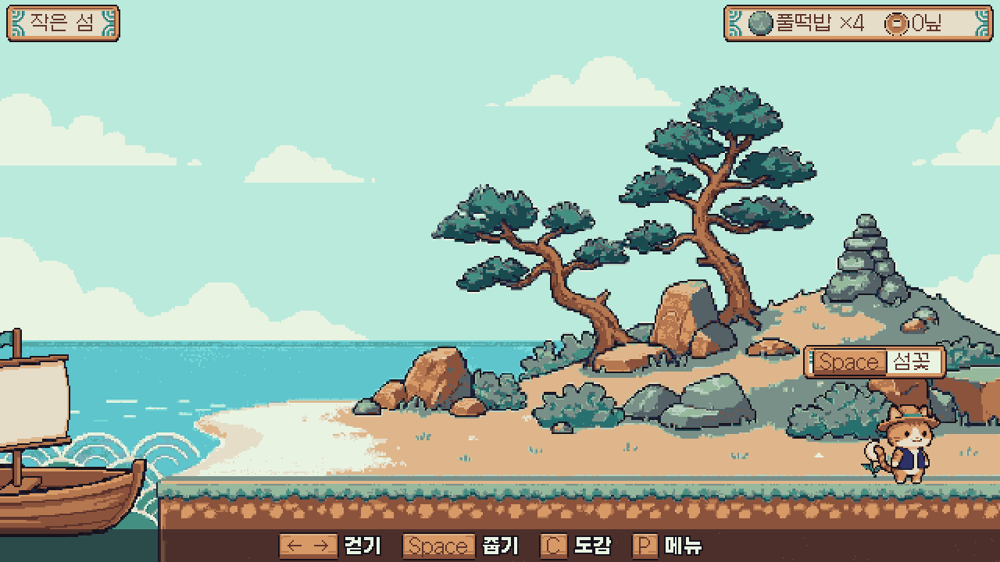
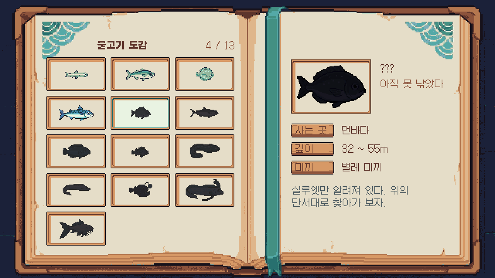

## 에셋

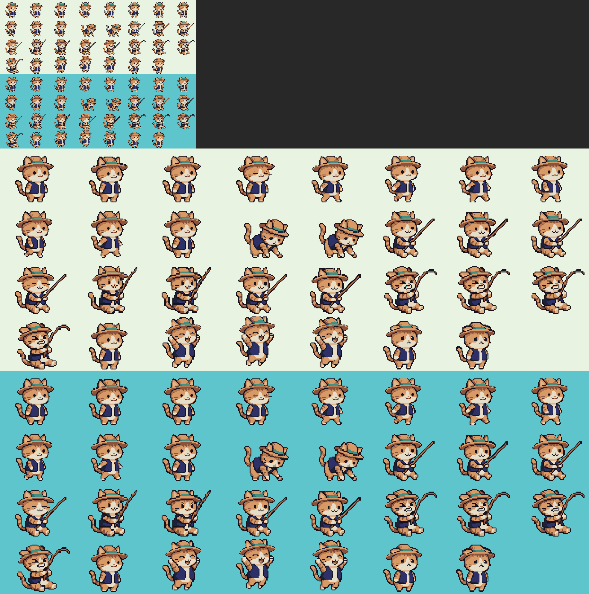

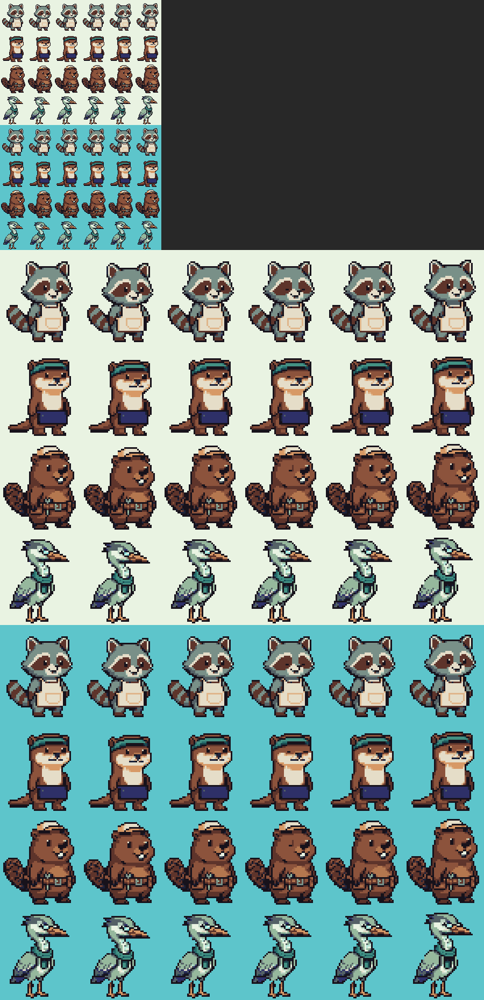

## 아직 약한 것

- 바다 화면의 고양이와 배가 기준 화면보다 작게 보이고, 물고기가 작고 드물다.
- 얕은 바다의 물속이 단조롭다(유적·해파리는 다른 구간에 있다).
- 고양이의 꼬리·귀 움직임 프레임이 없다. 가게 주인의 말하는 동작이 1픽셀 까딱임이다.
- 컷신의 용궁 안 장면은 걷는 프레임 없이 통통 튀며 이동한다. 4컷과 닫는 3컷이 정적이다.
- 갈치·산갈치의 헤엄 동작이 어색하다.
- 소리는 측정만 했고 사람이 듣지 않았다. 효과음 5개(`talk`, `page`, `repair`, `pickup`, `release`)가 아직 없다.
- 성능: 평균 75fps지만 느린 프레임 기준 60fps를 이 환경에서 입증하지 못했다.

세부는 [`design/asset-status.md`](design/asset-status.md), 조작법은 [`design/play-guide.md`](design/play-guide.md).
